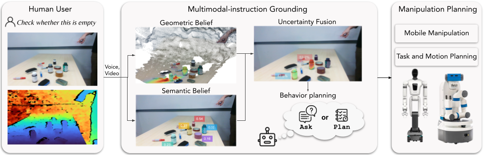
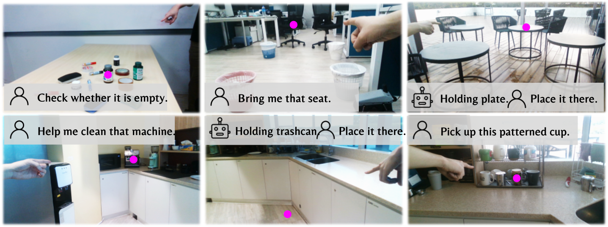

# MIGU

Code for [*MIGU: Multimodal Instruction Grounding under Uncertainty for
Manipulation Planning*](https://arxiv.org/pdf/2609.24995).



## ROS bag and planning interface

### Install

Requirements: Python 3.10, [uv](https://docs.astral.sh/uv/), ROS Noetic at
`/opt/ros/noetic`, and [pixi](https://pixi.sh/).

```bash
git clone https://github.com/MingkeLu/MIGU-Multimodal-Instruction-Grounding-under-Uncertainty-for-Manipulation-Planning.git
cd MIGU-Multimodal-Instruction-Grounding-under-Uncertainty-for-Manipulation-Planning
uv sync --extra ros

git clone https://github.com/threefruits/perception_services.git ../perception_services
cd ../perception_services
pixi run sam-server
```

The SAM service must answer at `http://127.0.0.1:4001/healthz`. In the MIGU
terminal, set the VLM credentials:

```bash
export OPENAI_API_KEY="your-api-key"
export OPENAI_BASE_URL="https://your-provider.example/v1"  # optional
```

### Input

For the bag demo, download the [example ROS bags](https://drive.google.com/drive/folders/157PIy2gKYoUREKCnXzNIIsYho62nqnrQ?usp=sharing)
to `bags/`. Camera calibration is read from `bags/camera_intrinsics.txt`.

For a live robot, publish:

| Topic | Type |
| --- | --- |
| `/head_camera/rgb/image_raw` | `sensor_msgs/Image` |
| `/head_camera/depth_registered/image` | `sensor_msgs/Image` |
| `/head_camera/rgb/camera_info` | `sensor_msgs/CameraInfo` |
| `/usr_instruction` | `std_msgs/String` |

### Run

Bag input:

```bash
uv run migu-bag-demo bags/*.bag --instruction "pick up this"
```

Live robot, in separate terminals:

```bash
source /opt/ros/noetic/setup.bash
uv run migu-grounding-node --config config.yaml --output-dir output/planning_interface/results
```

```bash
source /opt/ros/noetic/setup.bash
uv run migu-gesture-monitor --config config.yaml --output-dir output/planning_interface/grounding_inputs
```

```bash
source /opt/ros/noetic/setup.bash
uv run migu-publish-instruction --text "pick up this"
```

### Output

The planner subscribes to `/grounding_results` (`std_msgs/String`, JSON). Bag
runs also write:

```text
output/planning_interface/<timestamp>/
  grounding_inputs/   synchronized RGB-D pointing frames
  results/            one JSON result per pointing event
  logs/               ROS and node logs
```

## Dataset and experiment reproduction

### Dataset

The complete evaluation dataset is included in `captures/`:



```text
captures/<scene>/<frame>/
  rgb.png
  depth.npz
  metadata.json
  point.json
```

### Prepare dependencies and data

Start both perception services:

```bash
cd ../perception_services
pixi run owl-server   # port 4000
```

```bash
cd ../perception_services
pixi run sam-server   # port 4001
```

Then prepare the shared evaluation input:

```bash
cd ../MIGU-Multimodal-Instruction-Grounding-under-Uncertainty-for-Manipulation-Planning
uv sync
uv run migu-prepare-baselines
```

Prepared data is written to `batch_preparation/captures/input/`.

### Run MIGU

```bash
uv run migu --config config.yaml --analyse \
  --analysis-input-dir batch_preparation/captures/input
```

Results are written to `output/migu/<timestamp>/`; metrics are under
`output/migu/<timestamp>/ground_truth_analysis/`.

Baseline, ablation, and result-analysis commands are listed in
[Experiment reproduction](EXPERIMENTS.md).
